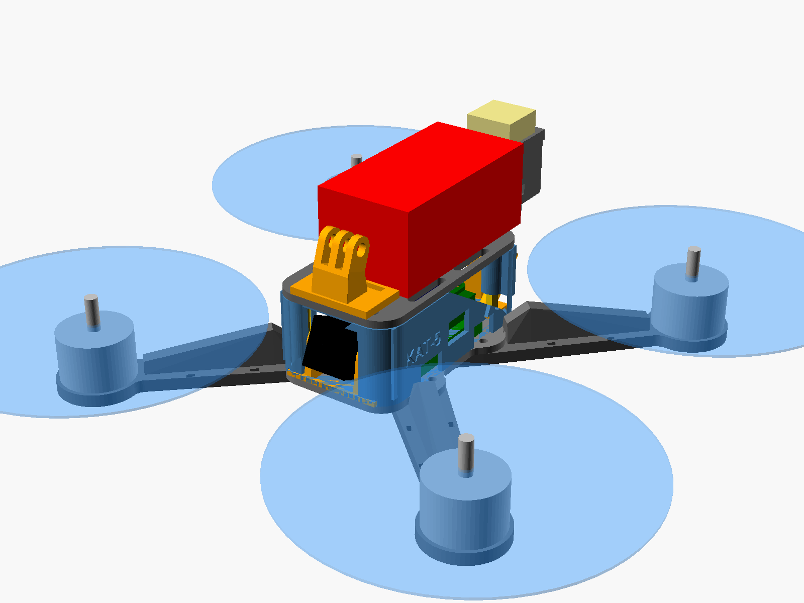
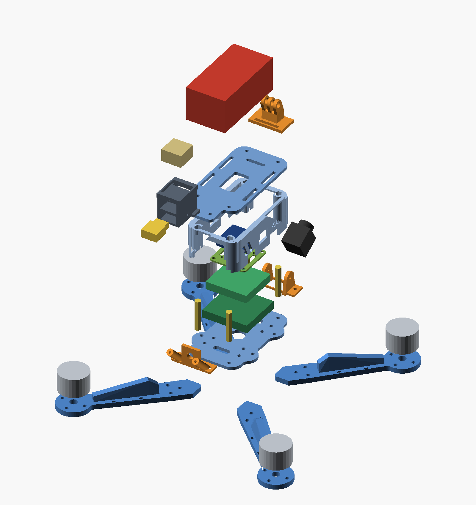
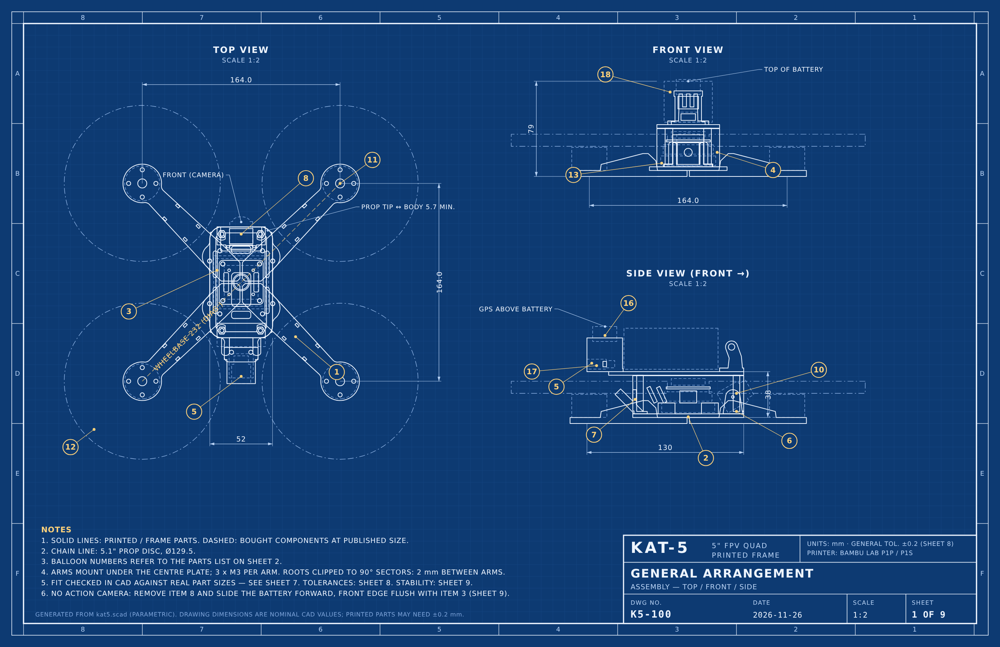

# KAT-5: printable 5" FPV freestyle quad

A parametric OpenSCAD frame designed to print on a **Bambu Lab P1P or P1S** in **PETG or PLA+**. The arms bolt on, so a broken one is a quick reprint. A canopy covers the electronics, and a rear tower holds the GPS and the battery connector.

| Assembled | Rear (GPS + XT60 tower) |
|---|---|
|  |  |



| Spec | Value |
|---|---|
| Layout | True-X, 232 mm wheelbase (motor to motor, diagonal), 52 × 92 mm body |
| Props | 5" (up to 5.1") |
| Motors | 22xx/23xx with a 16×16 M3 bolt pattern (2207, 2306, 2306.5) |
| Flight stack | 30.5×30.5 M3 FC and ESC |
| FPV camera | 19 mm "micro" camera on an M2 pivot, tilt 0–40° |
| Plate gap | 30 mm (M3×30 standoffs) |
| Battery | Top-mounted 6S 1100–1200 mAh, **up to 78 × 40 × 34 mm**, two straps |
| Arms | 4 bolt-on arms, 3 × M3 bolts each, interchangeable. Each root is clipped to its own 90° sector, leaving 2 mm between neighbours. |
| Frame weight | About 117 g printed: arms ≈80 g (4 × 20 g), plates ≈31 g, canopy ≈8 g, tower ≈7 g (from the STL volumes) |
| All-up weight | **≈628 g** with a 6S 1200 mAh battery (calculated from CAD + published part weights); ≈785 g with a full-size GoPro. See [`STABILITY.md`](STABILITY.md). |
| Largest part | Top plate, 52 × 112 mm. Four arms (129 × 32 mm) fit on one plate. |

## Drawings and fit check

- **[`drawings/KAT-5_drawings_print.pdf`](drawings/KAT-5_drawings_print.pdf):** the same 9 sheets in black on white, for printing. PNGs are in `drawings/print/`. On the wiring sheet, line styles replace the wire colours.
- **[`drawings/KAT-5_drawings.pdf`](drawings/KAT-5_drawings.pdf):** 9 blueprint sheets, 17 × 11 in. PNGs of each sheet are in `drawings/`.
  1. General arrangement (top, front and side views) with numbered callouts
  2. Exploded isometric, parts list and fasteners
  3. Arm and centre plate, dimensioned
  4. Top plate and canopy, dimensioned
  5. Tower, camera mount, antenna mount, GoPro mount and VTX plate
  6. Wiring diagram for the SpeedyBee F405 V4 stack on ArduPilot, with motor order and starting parameters
  7. Fit-check report
  8. Tolerances and fits: general tolerances, critical fits, and tolerance stack-ups for bolt lengths and the canopy
  9. Stability and structure
- **[`KAT-5_parts_list.pdf`](drawings/KAT-5_parts_list.pdf) / [`PARTS_LIST.md`](PARTS_LIST.md):** a printable, tickable parts list with links and QR codes.
- **[`STABILITY.md`](STABILITY.md):** balance in four setups, landing stability, arm stiffness, vibration frequency and stress.
- **[`FIT_CHECK.md`](FIT_CHECK.md):** each recommended part was modelled at its published size and checked for collisions against the frame in CAD.
- **`tools/`:** the scripts that regenerate the drawings and the fit check from `kat5.scad`.



## Electronics and weight budget

The weights below are typical for each class of part, not measurements of specific products. Weigh your own parts and adjust.

| Part | Recommendation | Weight |
|---|---|---|
| Printed frame | 4 arms, centre plate, top plate (PETG) | 80 g |
| Canopy + GPS/XT60 tower | PETG | 16 g |
| TPU accessories | Camera, antenna and GoPro mounts | 9 g |
| Hardware | 4× aluminium M3×30 standoffs, about 38 M3 screws, nuts and grommets | 34 g |
| GPS + compass | M10, about 20–25 mm square | 10 g |
| Motors (×4) | 2207 or 2306, **1750–1950 KV on 6S**, or 2400–2700 KV on 4S | 128 g (32 g each) |
| Flight stack | 30.5 mm F7 or F4 FC with a 45–55 A 4-in-1 ESC (BLHeli_32 or AM32) | 22 g |
| Props (×4) | 5.1" tri-blade, e.g. 5.1×3.6×3 | 17 g |
| FPV system, analog | 19 mm micro camera and a 25–800 mW VTX | 14 g |
| FPV system, digital | DJI O3 / O4 or Walksnail-class air unit (instead of analog) | +22 g |
| Receiver | ELRS 2.4 GHz nano receiver | 2 g |
| Wiring | XT60 pigtail, low-ESR capacitor, wires and heat shrink | 12 g |
| Battery strap and pad | | 4 g |
| **Dry weight (no battery)** | | **~348 g analog / ~370 g digital** |
| Battery | 6S 1100–1300 mAh (recommended) or 4S 1500 mAh | 170–200 g |
| **All-up weight** | | **~520–550 g** |
| GoPro (optional) | Full-size Hero, or a stripped "naked" GoPro at about 30 g | +155 g |

**Power check:** a 2207 motor at about 1950 KV on 6S makes roughly 1.4–1.7 kg of static thrust with a 5.1" tri-blade. Four of them give about 6 kg in total, so:
- about **11:1 thrust-to-weight** at around 535 g with no GoPro, which is good for freestyle;
- about **9:1** with a full-size GoPro, which is still plenty, though it will feel heavier.

The bolt-on arms, canopy and tower add about 40 g over a one-piece frame. If you'd rather save that weight, the canopy is optional; the quad flies the same without it.

## Parts (`stl/`)

| File | Qty | Material | Notes |
|---|---|---|---|
| `arm.stl` | 4 (+2 spares) | PETG / PLA+ | Print flat, spine up. All four arms are identical. |
| `bottom_plate.stl` | 1 | PETG / PLA+ | Centre plate. The arms bolt underneath it. |
| `top_plate.stl` | 1 | PETG / PLA+ | Battery-strap slots, GoPro strap slot, and a rear tab for the tower. |
| `canopy.stl` | 1 | PETG / PLA (or TPU) | Shell between the plates with a camera window, vents, USB access and the engraved name. Print upright. A silk or matte PLA looks best; TPU survives crashes. |
| `gps_xt60_mount.stl` | 1 | PETG | XT60 socket holder with a GPS platform on top. Print upright. |
| `cam_mount.stl` | 1 | TPU 95A | Clamps under the two front standoffs. |
| `antenna_mount.stl` | 1 | TPU 95A | Clamps under the two rear standoffs. Holds the VTX SMA connector and two ELRS antenna tubes. |
| `gopro_mount.stl` | 1 | TPU 95A | 3-prong mount at a 20° tilt, strapped to the front of the top plate. |
| `vtx_plate.stl` | 1 | PETG | Bolts on top of the 30.5 mm stack and carries a 20 × 20 mm VTX (SpeedyBee TX800) on M2 nylon screws. |
| `test_coupon.stl` | 1 | PETG | **Print this first** (about 10 minutes). It checks the motor holes, stack holes, M2 hole, camera width, XT60 opening and GPS pocket on your printer. |
| `standoff.stl` | 4 | PETG | Optional. Too fat to fit inside the canopy, so use M3×30 aluminium standoffs (5–5.5 mm hex) if you fit the canopy. |

## Print settings (Bambu Studio)

**PETG / PLA+ structural parts (arms, plates, tower):**
- 0.4 mm nozzle, 0.2 mm layers.
- **6 walls**, 5 top and 5 bottom layers. The walls carry the load, so don't skimp on them.
- 40% gyroid infill. The arms end up close to solid anyway.
- Print flat. Layer lines then run along the arms, which is the strong direction for crash loads.
- Use a textured PEI plate, no supports and no brim.

**Canopy:** 3 walls (it's 1.2 mm thick), no infill needed, upright with no supports. The window tops bridge fine.
- PETG: 245 °C nozzle, 70 °C bed, part fan at about 40%. PLA+: 215 °C nozzle, 55 °C bed.

**TPU parts:**
- 0.2 mm layers, 3 walls, 25% infill, about 3 mm³/s maximum volumetric speed.
- On the P1S, feed the TPU from the external spool holder, not the AMS.
- Supports: none for the camera and antenna mounts. Tree supports under the GoPro prongs are optional.

## Hardware

- **Motors:** 16× M3×8 screws, in the 1 mm counterbores under the arm. The M3×6/7 screws that come with most 2207 motors are too short. **Check that the screw tips don't touch the motor windings**, and use 4 mm of thread into the motor at most.
- **VTX:** 4× M2 nylon screws and 1.5 mm spacers to fix it to the VTX plate.
- 4× M3×30 standoffs, plus 8× M3×8 screws to fix them to the plates.
- **Arms:** each arm takes 3 bolts. One is a stack bolt (below). The other two are 8× M3×12 with nylock nuts on top of the centre plate.
- **Stack:** 4× **M3×35** screws (M3×30 is too short), from under the arms up through the arm, the centre plate and the stack, with soft-mount grommets and nylock nuts on top.
- **Tower:** 2× M3×10 with nylock nuts for the GPS/XT60 tower.
- 2× M2×6 screws for the camera pivot.
- 1× M5 GoPro thumbscrew.
- 2× 20 mm battery straps, a grippy battery pad, and zip ties for the motor wires (there are slots in each arm).

## Assembly

1. Bolt the motors to the arm pads, with the screw heads underneath. Run the motor wires along the arm spine and zip-tie them through the arm slots.
2. Hold each arm under the centre plate and bolt it with its two M3×10 bolts. The four stack bolts go up from underneath through the arm roots and the plate, then carry the ESC and FC on soft-mount grommets.
3. **Replacing an arm:** remove its 2 bolts and its stack bolt, swap the arm, and bolt it back up. You don't need to take the stack off; the other three stack bolts hold it.
4. Put the TPU camera mount over the front standoff holes and the antenna mount over the rear ones. Then screw the standoffs down through them.
5. Fit the camera between the cradle walls with the two M2 pivot screws. Set the tilt to about 25–35° for freestyle. The TPU walls hold the angle by friction.
6. Fit the VTX SMA connector through the rear tab, then push the ELRS antenna leads into the two angled tubes.
7. Slide the canopy down over the standoffs, sitting on the centre plate, before fitting the top plate. Line the USB window up with your flight controller's port.
8. Bolt on the top plate. Then bolt the GPS/XT60 tower to the rear tab, with the arrow on the GPS pointing forward.
9. Run the XT60 pigtail out of the canopy's rear opening, up behind the top plate, and in through the tower's front wire hole. Push the XT60 into its pocket with the socket facing back, then zip-tie it through the slot.
10. Zip-tie or tape the GPS into the platform. Strap the GoPro mount to the front slot. The battery goes between them, held by two straps, and plugs into the XT60 at the back.

## Change the design

Every dimension is a parameter at the top of `kat5.scad`: wheelbase, plate thickness, spine height, motor pattern, standoff height, camera size and so on. To re-export a part:

```sh
openscad -D 'part="arm"' -o stl/arm.stl kat5.scad
openscad -D 'part="exploded"' kat5.scad      # preview the exploded view
```

Useful changes:
- **3" build:** set `wheelbase = 140`, `prop_d = 76`, `motor_spacing = 12`, `motor_hole_d = 2.2`, `stack_spacing = 20` and `stack_hole_d = 2.2`. Shrink the body to fit.
- **Stiffer arms:** raise `spine_h_peak` to 10–12, or `arm_t` to 5. The model is designed for PETG, which is about 10× less stiff than carbon fibre, so the arm spines provide most of the stiffness.
- **More camera room:** increase `standoff_h`. The canopy height follows it automatically.
- **Bigger GPS:** set `gps_size` to your module's width.

## Honest limitations

- **Stiffness:** a printed frame will never be as stiff as a carbon fibre one. Expect to lower the D-term and add filtering in your flight controller software if you see oscillation. Check the gyro trace with Blackbox before you push the PIDs.
- **Crashes:** printed arms break where carbon fibre would only scratch. Keep two spare arms printed; a swap takes a few minutes.
- **PLA:** plain PLA softens in summer heat and on warm motor mounts. Use PETG, or PLA+ at the very least.
