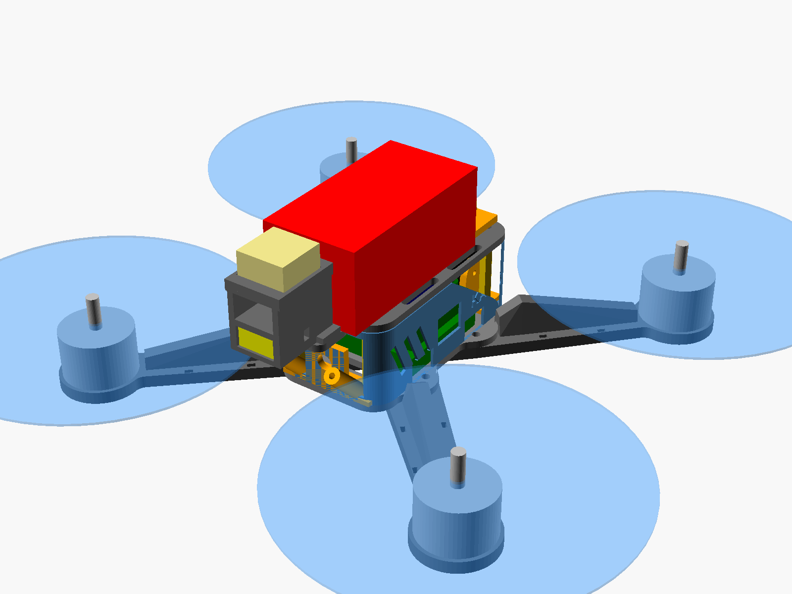

# KAT-5: printable 5" FPV freestyle quad

A parametric OpenSCAD frame designed to print on a **Bambu Lab P1P or P1S** in **PETG or PLA+**. The TPU accessories are optional.



| Spec | Value |
|---|---|
| Layout | True-X, 225 mm wheelbase (motor to motor, diagonal) |
| Props | 5" (up to 5.1") |
| Motors | 22xx/23xx with a 16×16 M3 bolt pattern (2207, 2306, 2306.5) |
| Flight stack | 30.5×30.5 M3 FC and ESC |
| FPV camera | 19 mm "micro" camera on an M2 pivot, tilt 0–40° |
| Plate gap | 30 mm (M3×30 standoffs) |
| Battery | Top-mounted, 4S/6S 1100–1500 mAh, two straps |
| Frame weight | About 55–60 g for the PETG unibody and top plate (62 g if fully solid, calculated from the STL volume). With 6 walls on 4 mm plates the print is nearly solid. |
| All-up weight | About 480–505 g with a 6S 1100 mAh battery; about 640–660 g with a full-size GoPro (see the weight budget below) |
| Largest part | Unibody, 191×191×12 mm (the P1 bed is 256×256) |

## Electronics and weight budget

The weights below are typical for each class of part, not measurements of specific products. Weigh your own parts and adjust.

| Part | Recommendation | Weight |
|---|---|---|
| Printed frame | Unibody and top plate in PETG | 57 g |
| TPU accessories | Camera, antenna and GoPro mounts | 9 g |
| Hardware | 4× aluminium M3×30 standoffs, about 28 M3 screws, nuts and grommets | 28 g |
| Motors (×4) | 2207 or 2306, **1750–1950 KV on 6S**, or 2400–2700 KV on 4S | 128 g (32 g each) |
| Flight stack | 30.5 mm F7 or F4 FC with a 45–55 A 4-in-1 ESC (BLHeli_32 or AM32) | 22 g |
| Props (×4) | 5.1" tri-blade, e.g. 5.1×3.6×3 | 17 g |
| FPV system, analog | 19 mm micro camera and a 25–800 mW VTX | 14 g |
| FPV system, digital | DJI O3 / O4 or Walksnail-class air unit (instead of analog) | +22 g |
| Receiver | ELRS 2.4 GHz nano receiver | 2 g |
| Wiring | XT60 pigtail, low-ESR capacitor, wires and heat shrink | 12 g |
| Battery strap and pad | | 4 g |
| **Dry weight (no battery)** | | **~295 g analog / ~317 g digital** |
| Battery | 6S 1100–1300 mAh (recommended) or 4S 1500 mAh | 170–200 g |
| **All-up weight** | | **~480–505 g** |
| GoPro (optional) | Full-size Hero, or a stripped "naked" GoPro at about 30 g | +155 g |

**Power check:** a 2207 motor at about 1950 KV on 6S makes roughly 1.4–1.7 kg of static thrust with a 5.1" tri-blade. Four of them give about 6 kg in total, so:
- about **12:1 thrust-to-weight** at around 500 g with no GoPro, which is good for freestyle;
- about **9:1** with a full-size GoPro, which is still plenty, though it will feel heavier.

The printed frame plus hardware weighs about 95 g. That is comparable to a typical carbon-fibre 5" frame (about 100–120 g with hardware), so the printed frame doesn't cost you weight. What it costs you is stiffness and crash strength.

## Parts (`stl/`)

| File | Qty | Material | Notes |
|---|---|---|---|
| `unibody.stl` | 1 | PETG / PLA+ | Bottom plate and arms in one piece. Print flat with the spines facing up. |
| `top_plate.stl` | 1 | PETG / PLA+ | Has the battery-strap slots and a GoPro strap slot. |
| `cam_mount.stl` | 1 | TPU 95A | Clamps under the two front standoffs. |
| `antenna_mount.stl` | 1 | TPU 95A | Clamps under the two rear standoffs. Holds the VTX SMA connector and two ELRS antenna tubes. |
| `gopro_mount.stl` | 1 | TPU 95A | 3-prong mount at a 20° tilt, strapped to the front of the top plate. |
| `standoff.stl` | 4 | PETG | Optional. M3×30 aluminium standoffs are stiffer and preferred. |

## Print settings (Bambu Studio)

**PETG / PLA+ parts (unibody, top plate):**
- 0.4 mm nozzle, 0.2 mm layers.
- **6 walls**, 5 top and 5 bottom layers. The walls carry the load, so don't skimp on them.
- 40% gyroid infill. The unibody ends up close to solid anyway.
- Print flat. Layer lines then run along the arms, which is the strong direction for crash loads.
- Use a textured PEI plate, no supports and no brim.
- PETG: 245 °C nozzle, 70 °C bed, part fan at about 40%. PLA+: 215 °C nozzle, 55 °C bed.

**TPU parts:**
- 0.2 mm layers, 3 walls, 25% infill, about 3 mm³/s maximum volumetric speed.
- On the P1S, feed the TPU from the external spool holder, not the AMS.
- Supports: none for the camera and antenna mounts. Tree supports under the GoPro prongs are optional.

## Hardware

- 16× M3×8 screws for the motors. **Check that the screw tips don't touch the motor windings.** Use 4 mm of thread into the motor at most.
- 4× M3×30 standoffs, plus 8× M3×8 screws to fix them to the plates.
- 4× M3×20–25 screws and nylon nuts for the stack, with soft-mount grommets.
- 2× M2×6 screws for the camera pivot.
- 1× M5 GoPro thumbscrew.
- 2× 20 mm battery straps, a grippy battery pad, and zip ties for the motor wires (there are slots in each arm).

## Assembly

1. Bolt the motors to the arm pads, with the screw heads underneath. Run the motor wires along the arm spine and zip-tie them through the arm slots.
2. Mount the ESC and FC on the 30.5 mm stack holes with soft-mount grommets.
3. Put the TPU camera mount over the front standoff holes and the antenna mount over the rear ones. Then screw the standoffs down through them.
4. Fit the camera between the cradle walls with the two M2 pivot screws. Set the tilt to about 25–35° for freestyle. The TPU walls hold the angle by friction.
5. Fit the VTX SMA connector through the rear tab, then push the ELRS antenna leads into the two angled tubes.
6. Bolt on the top plate and strap the GoPro mount to its front slot. The battery goes behind it, held by two straps.

## Change the design

Every dimension is a parameter at the top of `kat5.scad`: wheelbase, plate thickness, spine height, motor pattern, standoff height, camera size and so on. To re-export a part:

```sh
openscad -D 'part="unibody"' -o stl/unibody.stl kat5.scad
```

Useful changes:
- **3" build:** set `wheelbase = 140`, `prop_d = 76`, `motor_spacing = 12`, `motor_hole_d = 2.2`, `stack_spacing = 20` and `stack_hole_d = 2.2`. Shrink the body to fit.
- **Stiffer arms:** raise `rib_h_root` to 10–12, or `plate_t` to 5. The model is designed for PETG, which is about 10× less stiff than carbon fibre, so the arm spines provide most of the stiffness.
- **More camera room:** increase `standoff_h`.

## Honest limitations

- **Stiffness:** a printed frame will never be as stiff as a carbon fibre one. Expect to lower the D-term and add filtering in Betaflight if you see oscillation. Check the gyro trace with Blackbox before you push the PIDs.
- **Crashes:** printed arms break where carbon fibre would only scratch. Print a spare unibody to keep on hand.
- **PLA:** plain PLA softens in summer heat and on warm motor mounts. Use PETG, or PLA+ at the very least.
