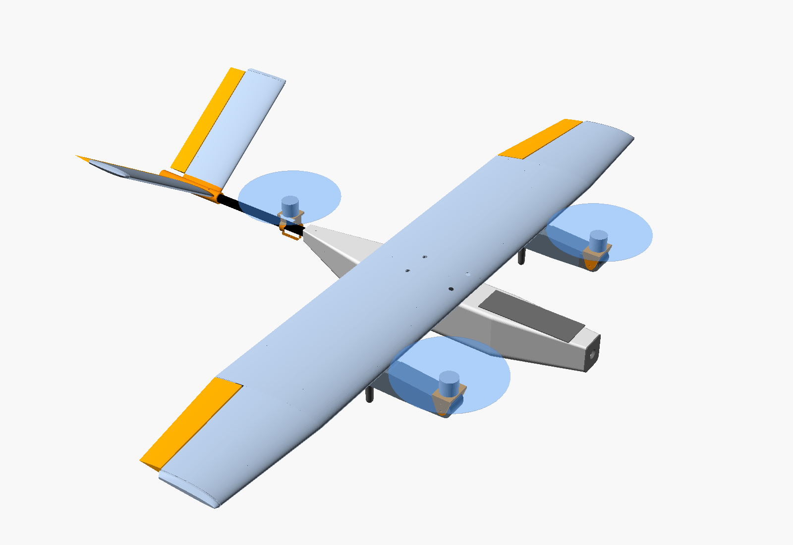
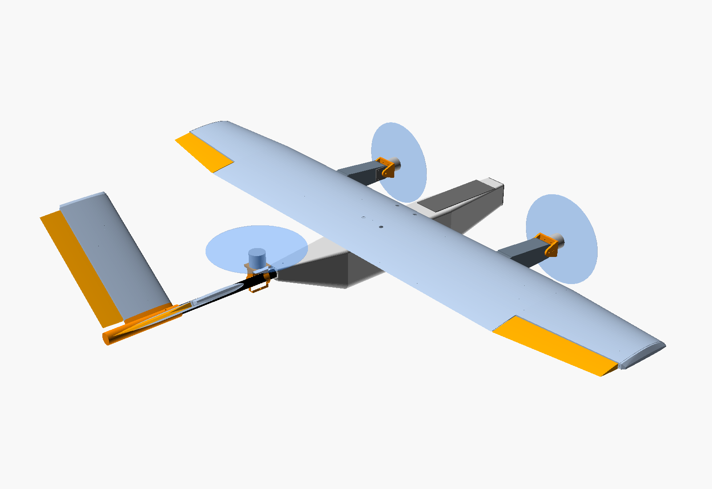

# KAT-TR: printable 1.2 m tilt-rotor VTOL

A plane that takes off and lands like a drone. Two front motors tilt from straight up (hover) to forward (cruise). A third motor on the tail boom faces up and only runs in hover. Every printed part fits a **Bambu Lab P1P/P1S**. The airframe is lightweight PLA (LW-PLA); the motor pods, tilt arms and mounts are PETG.

You fly it from a **computer screen** using a handheld controller, with no goggles. See [Video to your computer](#video-to-your-computer-no-goggles).

| Hover | Cruise |
|---|---|
|  |  |

> **Status: designed but not yet built or flown.** The weights and CG below are calculated, not measured. Tilt-rotors are the hardest VTOL layout to tune. Practice in the simulator first (see [Flight software](#flight-software-ardupilot)).

## Specs

| Spec | Value |
|---|---|
| Wingspan / length | 1200 mm / 895 mm |
| Wing | NACA 2412, 200 mm chord tapering to 150 mm at the tips, 23 dm² |
| Tail | V-tail, NACA 0009, 35° dihedral |
| All-up weight | **≈1.68 kg** with a 4S 4000 mAh LiPo (calculated) |
| Wing loading | 73 g/dm² |
| Stall / cruise | ≈10 m/s / ≈17 m/s (36–38 mph) |
| Hover thrust split | Rear motor 34%, each front motor 33% (≈570 g each) |
| Balance point (CG) | **56 mm behind the wing leading edge**, motors forward |
| Flight time (estimate) | 25–35 min mostly cruising; 8–10 min if you only hover |

## How it flies

1. **Takeoff:** all three motors point up and it lifts off like a tricopter. It yaws by tilting the two front motors in opposite directions.
2. **Transition:** the front motors tilt forward and the plane speeds up. Once the wing is flying (about 13 m/s), the rear motor stops.
3. **Cruise:** it flies like a normal plane on the two front motors, steering with the ailerons and V-tail.
4. **Landing:** it slows down, the motors tilt back up, and it descends vertically onto its two legs and belly.

ArduPilot handles all of this automatically, including return-to-home and GPS missions.

## Parts (`stl/`)

All parts are exported in their print orientation. `_L` / `_R` are mirror pairs.

| Part | Qty | Material | Print notes |
|---|---|---|---|
| `wing_1_L/R`, `wing_2_L/R`, `wing_3_L/R` | 1 each | LW-PLA | Thin-wall: stands on the root end, see settings below |
| `aileron_L/R` | 1 each | LW-PLA | 2 walls, 5% infill |
| `wingtip_L/R` | 1 each | LW-PLA | Normal settings, plug end down |
| `fuse_nose`, `fuse_center`, `fuse_tail` | 1 each | LW-PLA | Thin-wall, 2 lines; stands on its bulkhead ring |
| `hatch`, `camera_plate` | 1 each | PETG or PLA | Normal settings |
| `wing_mount_plate` | 1 | PETG | Glued under the wing saddle; has nut traps for 4× M4 |
| `bolt_tube` | 4 | PETG | Glued through the wing at the 4 bolt holes |
| `pod_L/R` | 1 each | PETG | On its side, 3 walls, 15% gyroid, tree supports |
| `servo_cover` | 2 | PETG | Flat |
| `tilt_mount_L/R` | 1 each | PETG (or PA-CF) | Plate down, 5 walls, 40% infill |
| `landing_leg` | 2 | TPU 95A | Peg up |
| `rear_motor_mount` | 1 | PETG | 4 walls, 30% |
| `tail_mount` | 1 | PETG | Tree supports under the tail stubs |
| `vtail_panel` | 2 | LW-PLA | Thin-wall, like the wing |
| `ruddervator` | 2 | LW-PLA | 2 walls, 5% infill |
| `vtail_tip` | 2 | LW-PLA | Normal settings |
| `control_horn` | 4 | PETG | Flat |
| `servo_tray` | 4 | PETG | Aileron servos in the wing, V-tail servos in the fuselage |
| `boom_servo_mount` | 0 | PETG | Optional. Don't use it unless the plane ends up nose-heavy. |

### Thin-wall LW-PLA settings (wing, fuselage, V-tail)

The parts are modelled with a 0.45 mm skin and 0.5 mm internal diagonal ribs, so the slicer prints every wall as a single line.

- 1 wall, **0% infill**, **0 top layers**, 3 bottom layers. The bottom layers form the bulkhead you glue the next section to.
- Turn on thin-wall detection (Arachne wall generator).
- Foam the LW-PLA at about 230–250 °C, then lower the flow to about 45–55% so lines come out at 0.45 mm. **Calibrate with a test print first.** The weights above assume foamed LW-PLA.
- Turn off retraction or keep it very short, slow outer walls to about 60 mm/s, and run the part fan low.
- The tops of the sections are open on purpose. Each joint is closed by the next section's bulkhead or by the wingtip plug.

## Carbon and hardware

| Item | Size | Use |
|---|---|---|
| Carbon tube | 10 × 8 mm, 1000 mm | Main wing spar, through both wing halves |
| Carbon rod | 4 mm, 800 mm | Rear wing rod (sections 1 and 2) |
| Carbon tube | 16 × 14 mm, 400 mm | Tail boom (cut to 395 mm) |
| Carbon rod | 4 mm, 2 × 240 mm | V-tail panel spars |
| Nylon bolts | M4 × 35, 4× | Wing to fuselage. They shear off in a crash to protect the wing. |
| Bolts | M3, assorted | Pivots (with nylock nuts), boom clamps, motors |
| Screws | M2 × 8, 8× | Servo covers |
| Pushrods | 1.5 mm carbon or 0.8 mm steel in tubes | Ailerons and V-tail |
| Hinge tape, CA glue + kicker, foam tape, battery strap | | |

## Electronics and weight budget

Component weights are typical for each class, not specific products. Weigh yours and rerun the CG check.

| Part | Recommendation | Weight |
|---|---|---|
| Printed parts | All of the above | 606 g |
| Carbon | Spar, rods and boom | 98 g |
| Motors (×3) | 2806.5–2807 class, about 1300 KV on 6S or 1700 KV on 4S. **≥1.2 kg max thrust each** on a 7" prop. | 150 g |
| Props (×3) | 7" two-blade. The front pair spins in opposite directions; the rear can be either. | 27 g |
| ESCs (×3) | 35–45 A single ESCs, front ones inside the pods | 36 g |
| Tilt servos (×2) | **Metal-gear digital, MG90S size (23 × 12 mm), ≥2.5 kg·cm.** These carry the front motors, so don't use cheap plastic-gear servos. | 28 g |
| Control servos (×4) | 9 g digital metal gear | 36 g |
| Flight controller | ArduPilot "wing" board with H743 processor (e.g. Matek H743-WING class) | 25 g |
| GPS + compass | M10 GPS with compass | 15 g |
| Airspeed sensor | Digital sensor + pitot tube (ArduPilot needs it for transitions) | 12 g |
| Receiver | ExpressLRS 2.4 GHz | 3 g |
| Video system | See below | 50 g |
| Remote ID | Broadcast module (required in the US for anything over 250 g) | 8 g |
| Wiring, glue, hardware | | 146 g |
| Battery | **4S 4000 mAh LiPo** (≈440 g) | 440 g |
| **All-up weight** | | **≈1680 g** |

### Balance

- Battery center goes about **105 mm ahead of the wing leading edge**, under the nose hatch. Slide it to trim.
- Balance point: **56 mm behind the leading edge** with the front motors tilted forward. It moves back about 3 mm in hover, which ArduPilot handles.
- Put the video unit and flight controller **forward** (in the nose and front of the center section), and the V-tail servos **inside the fuselage**, not on the boom. Mounting them on the boom makes the plane tail-heavy.

## Video to your computer (no goggles)

You want the camera feed on a laptop or PC screen. There are two ways to do it:

**Option A: digital HD with OpenIPC (recommended)**
- **On the plane:** an OpenIPC-based HD air unit and camera (for example a RunCam WiFiLink-class unit, or an SSC338Q board with an IMX415 camera). It transmits 720p/1080p over 5.8 GHz Wi-Fi.
- **On the computer:** a USB Wi-Fi adapter with an RTL8812AU or RTL8812EU chip, plus the OpenIPC ground software (fpv4win on Windows, or wfb-ng / PixelPilot). Latency is about 50–100 ms.
- **Range:** typically 1–3 km with good antennas. It's open source and still changing quickly, so check current hardware compatibility before buying.

**Option B: analog with a USB receiver (cheapest and simplest)**
- **On the plane:** an analog camera and video transmitter.
- **On the computer:** a 5.8 GHz "UVC" USB receiver, which shows up as a webcam. Open it in any camera app or OBS.
- **Trade-offs:** very low latency and very cheap, but the picture is standard-definition and noisy at range.

**Telemetry on the same screen:** run Mission Planner or QGroundControl on the laptop for the map, battery, altitude and attitude display. They can get telemetry through ExpressLRS's MAVLink mode or a small telemetry radio. Mission Planner can also overlay that display on the live video.

**The controller.** Use a handheld ExpressLRS radio (for example a Radiomaster Pocket or Boxer) as your main control link. It's independent of the laptop, so the plane stays controllable if the computer or Wi-Fi hiccups. That matters most during hover and transition.
- **Same radio for practice:** it plugs into the PC over USB as a joystick, so you can practice with it in the simulator.
- **Xbox-style gamepad:** you can fly through QGroundControl or Mission Planner over the telemetry link, but don't make that your only control link on a VTOL.

## Flight software (ArduPilot)

Use ArduPlane with QuadPlane enabled. Starting points (check the ArduPilot tilt-rotor docs for your firmware version):

| Parameter | Value | Meaning |
|---|---|---|
| `Q_ENABLE` | 1 | VTOL on |
| `Q_FRAME_CLASS` | 7 | Tricopter |
| `Q_TILT_ENABLE` | 1 | Tilt-rotor |
| `Q_TILT_TYPE` | 2 | Continuous tilt with vectored yaw |
| `Q_TILT_MASK` | 3 | Motors 1 and 2 tilt; motor 4 (rear) stays fixed |
| `Q_TILT_YAW_ANGLE` | 10–15 | Tilt range used for hover yaw |
| `SERVOx_FUNCTION` | 75 / 76 | Left / right tilt servos |
| `SERVOx_FUNCTION` | 79 / 80 | Left / right V-tail surfaces |
| `ARSPD_FBW_MIN` | 13 | Minimum airspeed (m/s) |

**Practice in the simulator first:** ArduPilot's SITL simulator has a tilt-tricopter quadplane model. Learn hover, transition and landing there with your radio plugged into the PC.

**First flights:**
1. Do hover-only tests at low altitude.
2. Tune hover.
3. Try transitions at a safe height, with return-to-home and failsafes set up.

## Assembly outline

1. **Wing:** glue the sections of each half together on the spar and rear rod. Fit each pod's two tongues up through the slots in `wing_2`, then slide the spar and rod through them. Glue the wing halves at the root, fit the 4 bolt tubes, and add the wingtips and ailerons (hinge tape on top).
2. **Pods:**
   1. Put the tilt servo in from the side, fit `servo_cover`, and fit the `tilt_mount` yoke. The servo horn screws into the recess in the right arm; the left arm pivots on an M3 bolt with a nylock nut.
   2. Set the servos so 0° on the yoke means straight up.
   3. Put the ESC inside the pod and push the leg into its socket.
3. **Fuselage:** glue the nose, center and tail sections together. Glue in `wing_mount_plate` with M4 nuts in the traps, and the camera plate at the nose. Glue the boom into the tail socket and add the M3 cross bolt.
4. **Tail:** slide `rear_motor_mount` and `tail_mount` onto the boom, then glue the V-tail panels onto the stubs with their 4 mm rods.
5. **Electronics:**
   - Battery under the hatch.
   - Video unit and flight controller in the front of the fuselage.
   - GPS on top of the tail section, behind the wing.
   - Pitot tube clear of prop wash.
6. **Check the balance point** (56 mm behind the leading edge) before every flight with a new setup.

## Rules (US)

- **Registration:** this plane is over 250 g, so register it with the FAA ($5) and pass the free TRUST test.
- **Remote ID:** it needs a Remote ID broadcast module.
- **Line of sight:** flying from a screen counts the same as goggles. You need a **visual observer** next to you who keeps the plane in sight, and you stay under 400 ft.

Rules differ in other countries, so check your local ones.

## Change the design

Every dimension is a parameter at the top of `kat_tr.scad`: chords, span, airfoil, skin and rib thickness, spar sizes, pod position, tilt geometry, tail size and dihedral. To re-export a part:

```sh
openscad -D 'part="wing_2_L"' -o stl/wing_2_L.stl kat_tr.scad
openscad -D 'part="assembly"' -D tilt=90 kat_tr.scad    # preview in cruise configuration
```

## Known limitations

- **Not flown:** expect to adjust things after the first build, such as servo fit, wire routing and how the hatch closes.
- **Weight:** about 1.68 kg is on the heavy side for 1.2 m. A 4S 3300 mAh battery saves about 80 g at the cost of flight time; then move it forward to keep the balance point.
- **LW-PLA and heat:** LW-PLA softens in heat. Don't leave it in a hot car, and paint it a light color.
- **Tilt servos:** these are the critical parts. Check that they hold the motor firmly at full throttle before flying.
